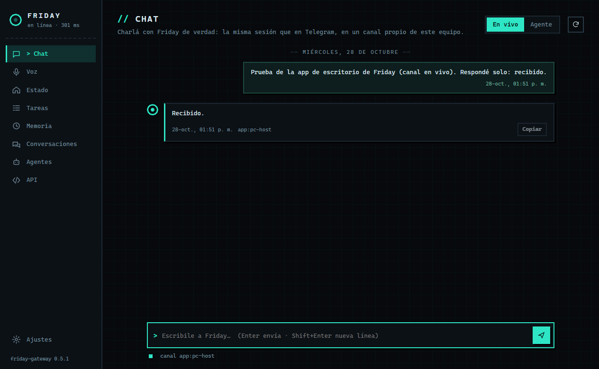
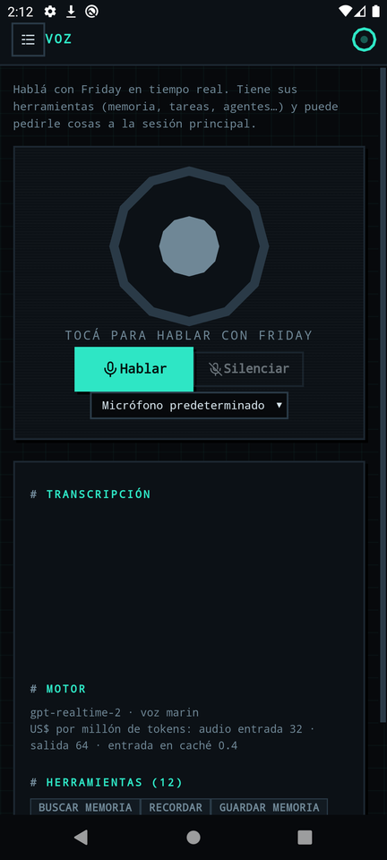
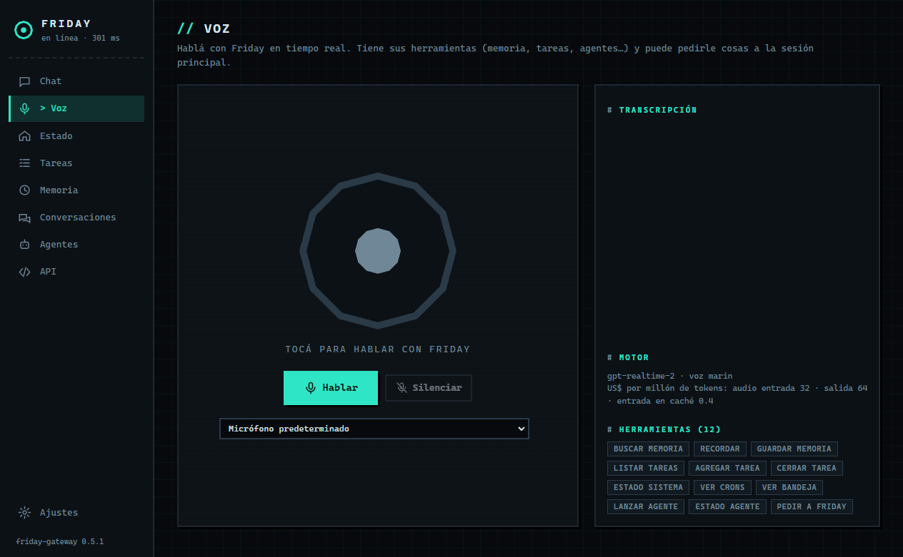
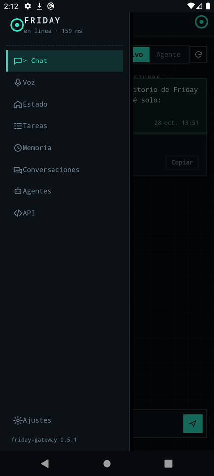

<p align="center"></p>

# Friday App — desktop & Android client

A client for [Friday](https://github.com/missingus3r/friday-showcase), the 24/7 assistant built on Claude Code. Talk to the **live Friday session**, use **real-time voice**, and browse memory, tasks, agents and system health from your PC or phone — on a channel of its own, kept in sync with Telegram.

- **Desktop:** Electron, Windows portable `.exe`.
- **Android:** Capacitor, `.apk`.
- Both apps share the same UI (`renderer/`). Only the bridge that talks to the gateway differs.

<p align="center">
  
  
</p>

> ⚠️ **Not a turnkey product.** The app talks to **friday-gateway**, a small FastAPI service in front of Friday's memory, tasks, agents and Telegram ledger. Friday generated that gateway for its own setup; it is not part of [SETUP.md](https://github.com/missingus3r/friday-showcase/blob/main/SETUP.md) yet. Treat this repo as a reference client: the endpoints it expects are listed below.

## Features

| Section | What it does | Gateway endpoints |
|---|---|---|
| Chat › Live | Chat with the real Friday session. Each device gets its own channel (`app:<node>`). | `POST /chat`, `GET /chat/messages` |
| Chat › Agent | Launch a background `claude -p` agent and get its result | `/agents` |
| Voice | Real-time voice (OpenAI Realtime bridge) with Friday's tools: memory, tasks, agents, and "ask the main session" | WebSocket `/live?token=`, `GET /live/tools` |
| Status | Health check, collector inbox, collectors and session crons | `/health`, `/bandeja`, `/crons` |
| Tasks | List, add and close reminders | `/tareas` |
| Memory | Search, recall a topic, list recent, save new | `/memory/*` |
| Conversations | Unified ledger (Telegram + every app node) and memory history | `/chat/history`, `/conversation/recent` |
| Agents | List, detail, cost, kill | `/agents` |
| API | Explorer generated live from `/openapi.json`, so new routes show up automatically | all |

<p align="center">
  
  
</p>

## One token, nothing else

The only setup is a single **app token**. Friday issues it on Telegram ("token para la app"), and it identifies the device as a node. The gateway's master token is rejected on purpose.

- **Desktop:** paste the token. The gateway defaults to `http://friday.local:8800`; you can change it under *Advanced*.
- **Android:** paste the **link** Friday sends, usually an ngrok URL with the token inside. Accepted forms:
  `https://xxxx.ngrok-free.app/?token=TOKEN` (recommended), `?t=`, `?key=`, `#token=`, `#TOKEN`, `https://TOKEN@host`, or the token as the last path segment.

Where the token is stored:
- **Desktop:** encrypted with Electron `safeStorage` (Windows DPAPI).
- **Android:** in the app's private Preferences.

## Build

Desktop (Node 20+):

```bash
npm install
npm start            # run from source
npm run dist         # dist/Friday-<version>-portable.exe
```

Android (JDK 17, Android SDK 34):

```bash
cd mobile
npm install
npm run apk          # mobile/android/app/build/outputs/apk/debug/app-debug.apk
```

`mobile/build-www.js` copies `renderer/` into `mobile/www` and adds `mobile/src/bridge.js`. The bridge implements the same `window.friday` API that the Electron preload exposes:
- HTTP goes through Capacitor's native client, so there are no CORS issues.
- Every request sends `ngrok-skip-browser-warning`.
- The app's user agent is non-browser, so ngrok's interstitial doesn't block the voice WebSocket.

The Android project in `mobile/android` is committed (don't re-run `cap add`) and already includes:
- microphone permission;
- cleartext traffic, for LAN gateways;
- dark system bars;
- the pixel-art icon and splash.

## Notes

- `FRIDAY_PROFILE=<name>` runs a second desktop instance with its own config: a different token, so a different node.
- The gateway evolves quickly. If something breaks, check `/openapi.json` first. The voice protocol is documented by the gateway's `/live/test` page: PCM16 mono at 24 kHz in, and `audio` / `interrupt` / `transcript` / `tool` / `error` messages out.
- On Windows, if `electron-builder` fails with *Cannot create symbolic link* (winCodeSign), extract the cached `.7z` from `%LOCALAPPDATA%\electron-builder\Cache\winCodeSign` into a `winCodeSign-2.6.0` folder next to it, ignoring the darwin symlink errors, and retry.
